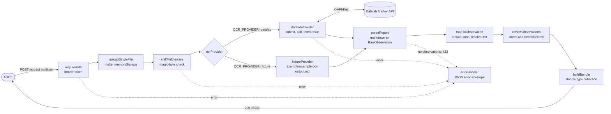

# medical-report-ocr

A Node.js service for developers who need structured lab results from scanned or PDF diagnostic reports: it OCRs the report with the Datalab Marker API and returns the lab observations as a FHIR R4 `Bundle`.

## Demo

No live deployment yet. The repo includes a Render blueprint (`render.yaml`) for a free-tier Docker deploy.

<!-- SCREENSHOT: terminal showing `curl -X POST /extract` against examples/sample-lab-report.pdf and the start of the returned Bundle. Save as docs/screenshot.png -->

## What it does

- One endpoint, `POST /extract`, takes a single JPEG, PNG, WebP or PDF upload (field name `file`, 10 MB default limit) behind a static bearer token.
- Checks the file type by magic bytes, not the client-declared `Content-Type`.
- Sends the file to Datalab, polls until the result is ready, and handles a `result_url` in place of inline markdown, `success: false` on an HTTP 200, and `429` rate limiting with `Retry-After` backoff.
- Parses the returned markdown tables into observations, skipping tables that look like results but are reference-band or risk-category guides.
- Maps each row to a FHIR R4 `Observation` (`status: preliminary`) with `valueQuantity`, `valueString` for qualitative results, or `dataAbsentReason` when the result cell is empty, plus `referenceRange` and `interpretation`.
- Adds a LOINC coding when the test name matches one of 46 codes in a local alias table (British spellings and common Indian-lab abbreviations such as `TLC`, `PCV`, `S. Creatinine`). Units resolve to UCUM through a static lookup table.
- Runs sanity checks on every observation (missing value, non-numeric value, missing unit, incoherent range, unit mismatch, implausible value that looks like a dropped decimal point). Flagged observations get a FHIR `note` and their name in `meta.needsReview`; nothing is rejected.
- Fixture mode (`OCR_PROVIDER=fixture`) replays a saved Datalab response so the whole pipeline runs without an account or network access.

## Architecture



Everything after the OCR call is a pure function over plain data, which is why the parser, mapper and validator are tested from saved fixtures and why fixture mode is the same pipeline with a stored string in place of the API call. The table filter accepts a markdown table only if two data rows carry a plain numeric value in the same column, or one row carries a scalar value and the table has a column of recognised units; real reports print reference guides with the same headers as result tables, and this rule separates the two. The implausibility check asks whether a power-of-ten rescale would bring a value back inside its range, because a "more than 10x the reference high" rule cannot catch an in-range value whose decimal point was dropped. Interpretation is left out when there is nothing to derive it from (no range, or a comparator value like `<0.5`) instead of defaulting to "Normal". `valueQuantity.system` and `.code` are set only when the unit maps to a known UCUM code; otherwise only the printed `.unit` is kept. The Datalab poll is cancelled through an `AbortController` when the client disconnects, so credits are not spent on a response nobody will read.

## FHIR output

A trimmed entry from the saved run in `examples/sample-fhir-bundle.json` (54 observations from the 7-page sample report):

```json
{
  "resourceType": "Bundle",
  "type": "collection",
  "timestamp": "2026-08-04T14:12:06.000Z",
  "entry": [
    {
      "fullUrl": "urn:uuid:de2a0cec-14ef-4bac-b401-555bad48f48d",
      "resource": {
        "resourceType": "Observation",
        "id": "de2a0cec-14ef-4bac-b401-555bad48f48d",
        "status": "preliminary",
        "code": {
          "text": "Hemoglobin (Photometry)",
          "coding": [{ "system": "http://loinc.org", "code": "718-7", "display": "Hemoglobin" }]
        },
        "valueQuantity": { "value": 15, "unit": "g/dL", "system": "http://unitsofmeasure.org", "code": "g/dL" },
        "referenceRange": [
          {
            "low": { "value": 13, "unit": "g/dL", "system": "http://unitsofmeasure.org", "code": "g/dL" },
            "high": { "value": 17, "unit": "g/dL", "system": "http://unitsofmeasure.org", "code": "g/dL" }
          }
        ],
        "interpretation": [
          {
            "coding": [
              {
                "system": "http://terminology.hl7.org/CodeSystem/v3-ObservationInterpretation",
                "code": "N",
                "display": "Normal"
              }
            ]
          }
        ]
      }
    }
  ],
  "meta": {
    "source": "ocr-extraction",
    "needsReview": ["GFR Category (KDIGO Guideline 2012)", "BUN/Creatinine Ratio (Calculated)"]
  }
}
```

**`meta.needsReview` is not valid FHIR R4.** R4 `Meta` only defines `id`, `extension`, `versionId`, `lastUpdated`, `source`, `profile`, `security` and `tag`, so a strict validator will reject this field. The per-observation `note` carries the same information in a conformant place. A fully conformant version would move the list into a `Meta.extension` with its own `StructureDefinition` URL.

No patient identity or demographics are extracted. `Observation.subject` is omitted, which R4 allows (`0..1`).

## Errors

All errors use the envelope `{ "error": { "code": "...", "message": "..." } }`.

| Status | Codes | When |
|---|---|---|
| 400 | `NO_FILE_UPLOADED`, `UNSUPPORTED_FILE_TYPE`, `FILE_TOO_LARGE`, `UNEXPECTED_FIELD`, `TOO_MANY_FILES`, `MALFORMED_UPLOAD` | Bad or missing upload |
| 401 | `UNAUTHORIZED` | Missing or wrong bearer token |
| 404 | `NOT_FOUND` | Unknown route |
| 422 | `NO_OBSERVATIONS_FOUND` | OCR finished but no observations were parsed |
| 500 | `OCR_UPSTREAM_ERROR`, `INTERNAL_ERROR` | Datalab failure or unexpected error; no stack trace in the body |

`GET /health` returns `{ "status": "ok", "uptimeSeconds": n }` without auth and without calling Datalab, so probes do not spend API quota or tie this service's uptime to Datalab's.

## Stack

- Node.js 22+, TypeScript 5.9 (ES modules)
- Express 5, multer 2 (in-memory uploads), zod 4 (env validation), pino and pino-http (logging)
- `@types/fhir` for R4 resource types
- Vitest 4 and supertest for tests
- Docker (`node:22-alpine`, multi-stage, non-root user, `HEALTHCHECK` on `/health`), Docker Compose, Render blueprint
- External: Datalab Marker API for OCR

## Run it locally

Requires Node.js 22 or newer. The server listens on port 3000 by default.

**Without a Datalab account (fixture mode):**

```bash
npm install
cp .env.example .env
# in .env: set API_BEARER_TOKEN to any value and OCR_PROVIDER=fixture
npm run dev
```

Fixture mode replays `examples/sample-ocr-output.md`, a saved Datalab response for `examples/sample-lab-report.pdf`. It still checks auth and the uploaded file's type, but returns the same 54-observation Bundle whatever file you send.

**With a Datalab account:**

```bash
npm install
cp .env.example .env
# in .env: set API_BEARER_TOKEN and DATALAB_API_KEY (from datalab.to)
npm run dev
```

**Docker:**

```bash
cp .env.example .env   # then edit as above
docker compose up --build
```

**Try it:**

```bash
curl -X POST http://localhost:3000/extract \
  -H "Authorization: Bearer $API_BEARER_TOKEN" \
  -F "file=@examples/sample-lab-report.pdf;type=application/pdf"
```

**Production build:** `npm run build && npm start` (runs `dist/index.js`).

### Environment variables

| Variable | Required | Default | Notes |
|---|---|---|---|
| `API_BEARER_TOKEN` | yes | none | Clients send `Authorization: Bearer <token>`; compared with `timingSafeEqual` |
| `DATALAB_API_KEY` | yes, unless `OCR_PROVIDER=fixture` | none | Sent as `X-API-Key` |
| `DATALAB_API_URL` | no | `https://www.datalab.to/api/v1/marker` | Datalab submit endpoint; override to point at a different Datalab endpoint |
| `DATALAB_MODE` | no | `balanced` | `fast`, `balanced` or `accurate` |
| `DATALAB_POLL_INTERVAL_MS` | no | `2000` | |
| `DATALAB_POLL_TIMEOUT_MS` | no | `180000` | |
| `OCR_PROVIDER` | no | `datalab` | `datalab` or `fixture` |
| `OCR_FIXTURE_PATH` | no | `examples/sample-ocr-output.md` | Read only in fixture mode |
| `PORT` | no | `3000` | |
| `MAX_FILE_SIZE_BYTES` | no | `10485760` (10 MB) | |
| `LOG_LEVEL` | no | `info` | pino level |

The service validates these with zod at startup and refuses to start, listing each problem, if any are invalid. `request_check_url` and `result_url` from Datalab are only fetched if they are https and on the same host as `DATALAB_API_URL`, so a misconfigured or spoofed response cannot send the API key elsewhere.

### Deploy to Render

`render.yaml` defines a free-plan Docker web service with a health check on `/health`. Render generates `API_BEARER_TOKEN`; enter `DATALAB_API_KEY` in the dashboard on first deploy. The blueprint sets `DATALAB_MODE=fast` and `DATALAB_POLL_TIMEOUT_MS=90000` so a cold start plus OCR stays within the proxy timeout.

## Tests

```bash
npm test          # vitest run
npm run typecheck # type-checks src and tests
```

167 tests across 12 files, all passing (counted from `vitest run` output). The suite needs no credentials or network: Datalab calls are mocked, and the parser, mapper and regression tests run against `tests/fixtures/lalpath-cbc-panel.md`, a saved Datalab response for the bundled sample report. The sample PDF and fixtures have the signing doctors' names and the lab address removed. Validation checks are covered in `tests/validation.test.ts`.

## Project layout

```
src/
  app.ts, index.ts   Express app setup, request ids, 404 and error handling
  config.ts          zod-validated environment config
  routes/            POST /extract pipeline and GET /health
  middleware/        bearer auth, multer upload and magic-byte sniff, error envelope
  upload/            file signature detection (PDF, JPEG, PNG, WebP)
  ocr/               Datalab client (submit, poll, result fetch) and fixture provider
  parsing/           markdown table parser, reference ranges, unit resolution
  fhir/              Observation mapper, LOINC alias table, Bundle builder
  validation/        per-observation checks and needsReview collection
tests/               Vitest suites and the saved Datalab fixture
examples/            sample PDF report, its saved OCR markdown, and the resulting Bundle
Dockerfile, docker-compose.yml, render.yaml
```

## Privacy

Report content is treated as PHI. The service never logs OCR output or observation values. Each extraction logs counts only: pages, tables seen and accepted, rows seen, observations emitted, and rows dropped by reason, which is enough to spot a systematically empty parse without putting report content in a log line. Request logs carry only id, method, URL and status code.

The bundled sample report uses a placeholder patient name, not a real patient.

## Known limitations

- **The sample report is a clean digital PDF, not a camera photo.** The parser was built and tested against it, so skew, blur or heavier OCR damage from a phone photo may need parser changes.
- **Two-column layouts** (two test tables side by side that Marker merges into one wide table) are not handled, and the second half would likely be dropped.
- **Test names wrapped across two table rows** are not merged; the row is more likely dropped by the noise filter than mis-parsed.
- **Test names over 80 characters are truncated** with an ellipsis.
- **OCR errors pass through.** In the saved Datalab output for the bundled sample, the Uric Acid result cell is empty; the service emits it with `dataAbsentReason` and flags it in `needsReview` rather than guessing.
- **Observations are not deduplicated across pages**, since a report can legitimately repeat a test.
- **UCUM support is a static table**, not a full validator such as `@lhncbc/ucum-lhc`. Units outside it keep the printed text with no UCUM code.
